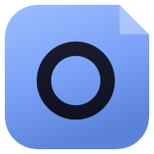

<p align="center">
  <!-- OmaPaper - App Icon -->
  <a href="https://github.com/abraham-ukachi/omapaper" target="_blank">
    
  </a>
</p>


<p align="center" style="width:512px; margin:0 auto;">
  <b>OmaPaper</b> is a design canvas for humans and AI agents, written in <b>Rust</b> 🦀 and painted in every <b>Omarchy</b> theme 🎨 — local-first, free, with no account, no cloud and no subscription. 📐
</p>

<p align="center" style="margin-top:12px;">
    <a href="https://github.com/abraham-ukachi/omapaper/releases" target="_blank"><b>Download the latest release &rarr;</b></a>
</p>


# `omapaper`

> IMPORTANT: This is a work in progress until version 1.0. v0.1 ships the full local core: daemon, MCP (stdio + HTTP), canvases, pages, frames, streaming, design tokens, comments, presence, PNG/PDF export, all 23 Omarchy themes and the desktop cockpit. 🚧

> MOTTO: We'll always do [**more**](#roadmap-) 😜


## What is OmaPaper? 📐

Picture your design workflow 🖼️: one tool for the canvas, another for the agent, a third for the tokens, a fourth for the comments — and a monthly seat fee on top of all of it. 😅

**OmaPaper** puts all of it in one place, on your own machine: a canvas where humans and agents design together, frame by frame, with the same tools an agent uses to read and edit the design — the tree, the selectors, the styles, the JSX export, the tokens, the comments, the screenshots. Every theme Omarchy ships, painted exactly like the rest of the Oma* family: two colours, a few mixes, iA Writer Mono, nothing else. 🎨

It is the love child of [**Doop**](https://github.com/abraham-ukachi/doop) and [**Paper**](https://paper.design): it takes Doop's whole-document frames, streaming, tokens, comments, presence and agent-first MCP surface, and Paper's node tools, JSX export, computed styles and design rules — and drops the parts that hurt: the cloud, the accounts, the workspaces, the seat fees. 🍼

**OmaPaper** is 100% Rust, runs on Omarchy (other OSes and devices are coming soon), stores everything in a single SQLite file on your disk, and never phones home. No login, no workspace, no "Team plan". 🦀

> NOTE: OmaPaper is a design canvas, not a general image editor. It speaks HTML, CSS and design tokens — the same language your codebase does. 🧑‍💻


## Why OmaPaper? 🤔 (Doop + Paper, none of the cons)

| | Doop | Paper | **OmaPaper** |
|:--|:--|:--|:--|
| Where it runs | Cloud (`doop.design`) or self-hosted Bun + Postgres | Electron desktop app, cloud sync | **Local daemon on your machine** |
| Account / login | Required (Better Auth) | Required | **None — zero accounts** |
| Pricing | Free personal; **Team $20/seat/mo ($192/seat/yr)**; Enterprise | Paid app | **Free, forever, no subscription** |
| Workspaces & seats | Workspaces are the paid part | — | **No workspaces, no seats, no roles** |
| Storage | Postgres | Cloud | **One SQLite file (`~/.local/share/omapaper/omapaper.db`)** |
| Agent surface | 42 MCP tools (stdio + HTTP) | MCP tools | **45 MCP tools (stdio + HTTP)** — the union of both, plus a few |
| Frames | Whole HTML documents | Artboards / nodes | **Whole HTML documents** (Doop strength) + Paper-style node tools |
| Streaming designs | `append_frame_html` chunks | — | ✅ chunked, viewers watch it appear |
| Design tokens | Typed CSS vars, per theme | Tokens | ✅ typed, per theme, CSS/Tailwind export |
| Comments / presence | Threads + live cursors | — | ✅ threads + live cursors + agent status |
| Export | PNG / PDF | PNG / PDF | ✅ PNG / PDF / HTML |
| Themes | — | — | **All 23 Omarchy themes + 2 ab-nextjs schemes**, live from `~/.config/omarchy/current/theme` |
| License | AGPL-3.0 | Proprietary | **MIT** |
| Built on | Bun / TypeScript / React | Electron | **100% Rust** |

> TIP: If you already self-host Doop with billing off, OmaPaper is the same idea with no Postgres, no Bun, no auth and no seat math — just `omapaperd` on `127.0.0.1:4310`. 🪶


## Screens 🖥️

The canvas is a single page served by the daemon at `http://127.0.0.1:4310/`:

| No. | Part | What it does |
|:----|:-----|:-------------|
| 1 | *`Top bar`* | Canvas name, page tabs, theme chip, Play mode, Export, comments toggle |
| 2 | *`Left rail`* | Pages and frames (name, size, approval state), new frame, duplicate, delete |
| 3 | *`Stage`* | Zoomable, pannable artboards; select, inspect, drag; inline edit in Play mode |
| 4 | *`Right panel`* | Selected node: tag, attributes, inline styles, children, computed styles, JSX |
| 5 | *`Tokens`* | Design tokens (colour, spacing, radius, typography, shadow) with per-theme values |
| 6 | *`Comments`* | Threads anchored to an element or a point on a page |
| 7 | *`Presence`* | Humans, tabs and agents on the canvas, with one-line status |
| 8 | *`Cockpit`* | Slint desktop window that starts the daemon and lists/opens canvases |

> NOTE: Reference mockups live in `docs/design`. 📸


## Tech stack & versions 🛠️

| Layer | Crate / lib | Version |
|:------|:------------|:--------|
| Language | Rust | 1.99 (edition 2021) |
| Engine | `omapaper-core` | model, theme, store, tokens, HTML, render, guide |
| MCP | `omapaper-mcp` | 46 tools, JSON-RPC over stdio + HTTP |
| Daemon | `omapaperd` | axum 0.7, tokio, REST + WebSocket |
| Desktop | `omapaper` (cockpit) | Slint 1.x |
| Canvas window | `omapaper-canvas` | GTK3 + WebKit2GTK 4.1 |
| Canvas UI | hand-written HTML/CSS/JS | no Node, no React, no build step |
| Storage | SQLite (rusqlite, bundled, WAL) | `~/.local/share/omapaper/omapaper.db` |
| HTML | html5ever + markup5ever_rcdom | in-house selector subset |
| Screenshots/PDF | headless Chromium | `OMAPPAPER_CHROMIUM` override |
| Themes | 23 Omarchy + 2 ab-nextjs schemes | live from `~/.config/omarchy/current/theme` |
| License | MIT | © Abraham Ukachi |

Binaries produced: `omapaper` (cockpit), `omapaperd` (daemon), `omapaper-mcp` (stdio MCP), `omapaper-canvas` (WebKit viewer).


## How it works 🧠

```
┌────────────────┐     JSON-RPC / REST / WS     ┌────────────────────┐
│  you / agent   │ ────────────────────────────▶ │  omapaperd (Rust)  │
│  (Claude, …)   │ ◀──────────────────────────── │  127.0.0.1:4310   │
└────────────────┘                              └─────────┬──────────┘
                                                          │
                              ┌───────────────────────────┼───────────────────────────┐
                              │                           │                           │
                       ┌──────▼──────┐            ┌───────▼───────┐           ┌───────▼───────┐
                       │  SQLite DB  │            │  canvas/ HTML │           │  Chromium     │
                       │  (frames,   │            │  (served at /)│           │  (PNG / PDF)  │
                       │  versions,  │            └───────┬───────┘           └───────────────┘
                       │  tokens,    │                    │
                       │  comments)  │            ┌───────▼───────┐
                       └─────────────┘            │ WebKit viewer  │
                                                  │ (GTK3 window) │
                                                  └───────────────┘
```

- A **canvas** holds **pages**, and pages hold **frames**. A frame is a complete HTML document (Doop strength) — `<!DOCTYPE html>`, `<head>`, `<style>`, `<body>` — so a design is just a web page you can open in any browser.
- Humans draw in the canvas (served at `/`); agents drive it through 45 MCP tools over stdio or HTTP at `/mcp`. Both see the same state, live, over the WebSocket at `/ws`.
- `append_frame_html` streams a design in chunks; viewers watch it appear. `get_frame_screenshot` renders the frame in headless Chromium so an agent can look at what it just drew.
- Design tokens are typed CSS custom properties (`--color-brand`) with one value per theme; frames reference them with `var(--color-brand)`, never the literal.
- Prototypes are attributes, not a separate file: `data-omapaper-on="click"` + `data-omapaper-action="frame:<id>"`. Play mode follows them with a back stack.
- Themes come from Omarchy (`~/.config/omarchy/current/theme`) and fall back to Tokyo Night; the cockpit paints itself from `Theme::live_omarchy()`.

Data lives under `~/.local/share/omapaper/` (override with `--data-dir` or `OMAPPAPER_DATA_DIR`). Set `OMAPPAPER_CHROMIUM` to point at a specific Chromium binary for screenshots/PDF.


## Build & run 🏗️

Requirements: Rust 1.99+, GTK3, WebKit2GTK 4.1, (optional) Chromium for screenshots/PDF.

```bash
# Build everything
cargo build --release

# Run the daemon (serves the canvas on :4310)
./target/release/omapaperd

# Open the cockpit (starts the daemon for you)
./target/release/omapaper

# Or open the canvas directly in a browser
xdg-open http://127.0.0.1:4310/
```

User-level install (no root):

```bash
./scripts/install.sh
```

Arch / Omarchy package:

```bash
cd packaging && makepkg -si
```

MCP client config (stdio):

```json
{
  "mcpServers": {
    "omapaper": {
      "command": "/path/to/omapaper-mcp",
      "args": []
    }
  }
}
```

MCP over HTTP: `http://127.0.0.1:4310/mcp` (JSON-RPC). See [`docs/mcp.md`](./docs/mcp.md) for all 46 tools.


## Roadmap 🗺️

- [x] v0.1 — full local core: daemon, MCP stdio/HTTP, canvases/pages/frames, streaming, tokens, comments, presence, PNG/PDF export, all Omarchy themes, desktop cockpit, launcher icon, docs & CI
- [ ] v0.2 — richer node editing (drag/resize handles, multi-select, undo/redo history UI), Figma/Paper import
- [ ] v0.3 — team sharing over LAN (read-only viewers, no seats, no billing)
- [ ] v0.4 — other OSes and devices (macOS, Windows, mobile viewers)
- [ ] v1.0 — stable API, plugin system, Omarchy app-store packaging

> MOTTO: We'll always do [**more**](#roadmap-) 😜


## More 📚

- [`AGENTS.md`](./AGENTS.md) — how to work on this repo (for humans and agents)
- [`CONTRIBUTING.md`](./CONTRIBUTING.md) — gitmoji commits, PR flow
- [`CHANGELOG.md`](./CHANGELOG.md) — release notes
- [`docs/mcp.md`](./docs/mcp.md) — the 45 MCP tools in detail
- Doop (the other parent): https://github.com/abraham-ukachi/doop
- Omarchy: https://omarchy.org
- Omacalc (theme reference): https://github.com/omacom-io/omacalc

Made with 🦀 and ☕ by [Abraham Ukachi](https://github.com/abraham-ukachi). MIT licensed.
</p>
PY